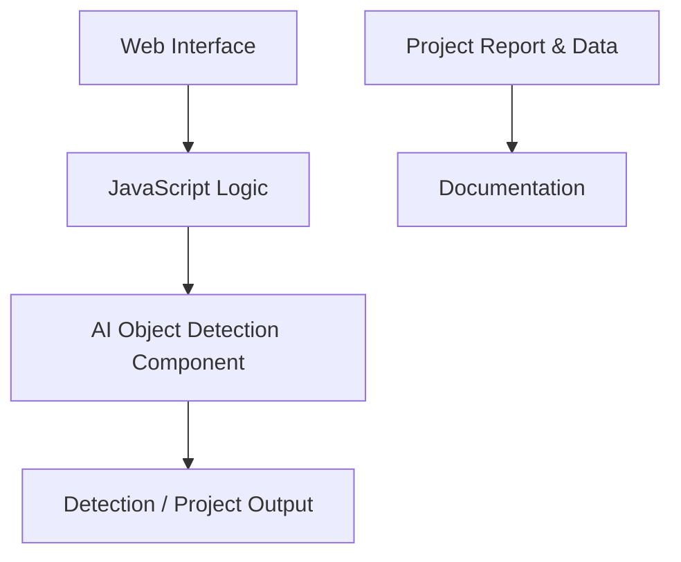

# 🎓 NIAMT Project

<b>An academic/project repository combining a web interface, project documentation and an AI object-detection component.</b>

## 🧭 What’s Inside
- Web interface: `index.html`, `script.js`, `stylr.css`
- `ai-object-detection-master/`: object-detection project resources
- `Abhishek_project_report[1].pdf`: project report
- `Dr. DK Prabhakar.xlsx`: spreadsheet/project data
- `oriantation Day1.png`: project/orientation visual asset

## 🧩 High-Level Architecture

## 🚀 Web Portion
The root HTML/CSS/JavaScript files can be opened through a browser or served using any static HTTP server.

## 🤖 AI Component
The `ai-object-detection-master` directory contains the object-detection portion of the project. Consult its own files/documentation for model-specific dependencies and execution instructions.

## 📚 Academic Documentation
The repository includes a project report and supporting spreadsheet. These materials provide context for the academic work and should be kept synchronized with major project changes.

## ⚠️ Data & Privacy
Review documents and spreadsheets before publishing if they contain personal, institutional or confidential information.

## 📄 License
No license file is currently declared.